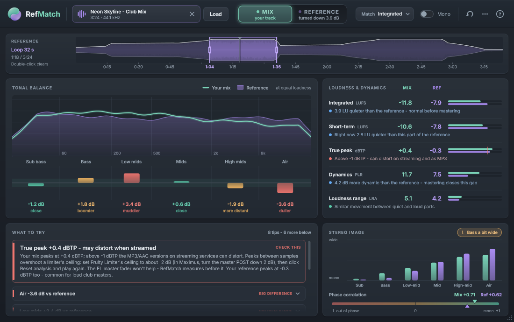

# RefMatch

A reference-track plugin for producers who mix by ear. Put it on FL Studio's master, load a released song you would
like your track to sound like, and switch between your mix and that reference with one click. RefMatch plays the
reference at the same loudness as your mix, so you hear the real differences instead of "the louder one sounds
better". It also explains the differences in plain language: which frequency ranges you have more or less of, how loud
and how squashed your mix is, how wide it is, and whether your bass holds up in mono. Every difference comes with one
concrete thing to try in FL Studio.

VST3 + CLAP + Standalone, Windows, built with JUCE 8.



## Install

**Got `RefMatch-Setup-1.0.0.exe`?** Close FL Studio, double-click it and click through (it asks for admin rights once).
It installs the VST3 (and the CLAP) into the standard plugin folders, needs nothing else on the PC, and adds an
uninstaller to *Settings > Apps*. Then continue with step 3 below. Making that installer yourself: see
*Share it with a friend* further down.

From the source code:

1. Build it (see *For developers* below). The plugin ends up in `build\RefMatch_artefacts\Release\`.
2. Copy it into the system plugin folders. Close FL Studio first (Windows can't replace a plugin that is loaded), then
   run this from the `RefMatch` folder in PowerShell. It asks for admin once:

   ```
   powershell -ExecutionPolicy Bypass -File scripts\install-plugin.ps1
   ```

   This copies `RefMatch.vst3` to `C:\Program Files\Common Files\VST3\` and `RefMatch.clap` to
   `C:\Program Files\Common Files\CLAP\`. You can also copy the `RefMatch.vst3` folder there by hand.
   No admin rights? Add `-CurrentUser` to the command. It installs into `%LOCALAPPDATA%\Programs\Common\VST3` (and
   `...\CLAP`) instead. FL doesn't look there by default: add that folder in FL's *Options > Manage plugins > Plugin
   search paths*. If FL still doesn't find RefMatch, use the normal install above.
3. In FL Studio: *Options > Manage plugins*, then click **Find installed plugins**.
4. Open the Mixer (F9) and select the **Master** track. In its effect slots on the right, click the first empty slot
   **below** your limiter and everything else on the master, and pick **RefMatch** (if it isn't in the short list,
   choose *More plugins...* and find it there, or star it as a favourite in the Plugin Manager). It must be the
   **last** effect on the master. Use the VST3 version.

### Why the last effect on the Master?

RefMatch has to hear what you hear: your whole mix after every effect on the master, including the limiter. When you
switch to the reference, RefMatch swaps the audio at that point, so the reference does not go through your master
effects (your limiter would squash it a second time). With **MIX** selected and **Mono** off, your audio passes through
untouched.

FL's master volume fader comes after the effect slots. It changes the volume of the mix and the reference alike, but it
does not change what RefMatch measures.

Exporting is safe: while FL renders a file, RefMatch always passes your mix through unchanged, even if REFERENCE or
Mono is switched on. When you reopen a project, RefMatch always starts on MIX.

## Quick start

The **?** button in the top-right corner shows a short version of this guide inside the plugin.

1. **Load a reference.** Drop an audio file (WAV, AIFF, FLAC, MP3 or OGG, up to 20 minutes) anywhere on RefMatch, or
   click **Load**. Loading and analysing take a few seconds.
2. **Loop the part you want to compare.** Drag across the reference waveform to make a loop, usually over the drop or
   the chorus (the waveform's height and white edge show where the song is loud). Drag the loop's edges to adjust it,
   click the waveform to jump, and double-click to go back to the whole track. The reference's numbers are measured on
   the loop.
3. **Play the same part of your song** in FL, for example by looping your drop in the playlist. If you have already
   played other parts, click **Reset analysis** (the round arrow, top right) first. After a few seconds the panels
   fill up.
4. **Switch A/B.** Click **MIX** and **REFERENCE** in the top bar while FL plays. The reference follows FL's song
   position and loops inside your loop. Level match (on by default) turns the reference down or up to your mix's
   loudness. What it does shows under REFERENCE, e.g. "turned down 3.9 dB".
5. **Read "What to try"**. Pick the top card, make one small change, click **Reset analysis** (the round arrow),
   play the same part again and compare.

## Choosing a reference

- A released, professionally mastered song **in your genre**, at a similar tempo and energy, whose sound you like.
- The best quality you can get: WAV or FLAC. A 320 kbps MP3 is fine. Low-quality MP3s and video rips lose the top end,
  which makes your mix look too bright in the Air band.
- Compare **the same kind of section**: drop with drop, breakdown with breakdown. A breakdown has much less sub bass and
  kick than a drop, so comparing it with the reference's drop gives misleading advice.
- Try two or three references over time. No single song is "correct".

## Reading the panels

### Tonal balance

The purple area is the reference's average spectrum and the mint line is your mix, both at the same loudness. The
picture is tilted upwards (+4.5 dB per octave) so a typical well-balanced song looks roughly flat. What matters is
where the line sits above the area (your mix has more there) or below it (less).

The six bars underneath sum it up per range, in dB compared with the reference (up = more, down = less), with a word
for how your mix tends to sound next to the reference ("close" when it is within 1.5 dB):

| Range     | Hz           | What lives there                          | More / less sounds     |
|-----------|--------------|-------------------------------------------|------------------------|
| Sub bass  | 20 - 60      | sub bass, 808, the tail of the kick       | heavier / lighter      |
| Bass      | 60 - 200     | body of the bass, punch of the kick       | boomier / thinner      |
| Low mids  | 200 - 500    | warmth, but also mud and boxiness         | muddier / colder       |
| Mids      | 500 - 2k     | body of vocals, synths and guitars        | honkier / more scooped |
| High mids | 2k - 6k      | presence and clarity                      | harsher / more distant |
| Air       | 6k - 20k     | brightness, cymbals, breath, sizzle       | brighter / duller      |

Colours: **teal** = within 1.5 dB (close), **amber** = 1.5 to 3 dB (worth a look), **coral** = 3 dB or more (big
difference). Hover a band to see what it means.

By default your mix's curve gives the most weight to the last half minute or so you played, and older audio fades out
of it gradually (*Analysis window: Recent* in the `...` menu), so it settles while you loop one section. Pauses and
silence don't wipe the picture. *Since reset* averages everything played since the last reset equally, which suits
judging a whole song.

### Loudness & dynamics

Your mix (MIX column) next to the reference (REF column), each row with a one-line verdict.

- **Integrated (LUFS)**: the average loudness of everything played since the last reset (for the reference: of the
  loop). Streaming services turn loud songs down to around -14 LUFS (the exact level depends on the service and its
  settings); club and EDM masters are often -9 to -6 LUFS. A mix before
  mastering is normally several LU quieter, and that's fine: level matching takes care of it while you compare. 1 LU
  is about 1 dB.
- **Short-term (LUFS)**: the loudness of the last 3 seconds, of your mix and of the reference as it plays.
- **True peak (dBTP)**: the highest peak since the last reset, including the peaks that appear between samples when the
  audio is converted. Leave some headroom on a finished master so the MP3 / AAC versions on streaming services are less
  likely to distort: below -1 dBTP is the usual target (Spotify asks for -2 dBTP when the master is louder than
  -14 LUFS). Many loud club masters go above that; RefMatch says so when your reference does too. Before mastering,
  plenty of headroom (for example -6 dBTP) is fine.
- **Dynamics (PLR)**: the peak-to-loudness ratio, how far the peaks rise above the average loudness. Lower = more
  squashed. Loud, heavily limited masters are around 6 to 9 dB; dynamic mixes 12 dB or more.
- **Loudness range (LRA, in LU)**: how much the loudness moves between the quiet and loud parts. A number appears after
  a few seconds, but it only means something after a minute or more that includes quiet and loud parts (ideally the
  whole song). Pop and EDM masters are often 3 to 7 LU.

### Stereo image

- **Width per band**: mint bars (your mix) next to purple bars (reference). 0 % = mono (everything in the middle),
  100 % = as wide as two unrelated channels. Sub and bass should be close to 0 %; the highs are usually the widest.
- **Phase correlation**: +1 = mono, 0 = very wide, below 0 = left and right cancel each other when played in mono. Most
  masters sit between +0.2 and +0.8.
- **Bass mono badge** (below 120 Hz): *Bass mono: OK*, *Bass a bit wide* (correlation below 0.8) or *Bass too wide*
  (below 0.5). Club systems, phones and Bluetooth speakers are mono or close to it, and a wide bass loses power there.
  Press **Mono** to hear it.

### What to try

Up to eight tips, the most important first. The top one is a large card; when the rest don't all fit, they become
one-line rows (hover one to read it, click to open it). Each tip says what differs, the measured number, what it
usually sounds like and one thing to try in FL (Fruity Parametric EQ 2, Fruity Limiter, the mixer's stereo separation
knob...). The tag says how much it matters:

- **BIG DIFFERENCE** (coral): a big difference from your reference.
- **CHECK THIS** (coral): a problem in your mix itself: a true peak above -1 dBTP, a bass that isn't mono-compatible,
  or left and right cancelling each other. (When your reference peaks at least as high, the true-peak tip is only
  WORTH A LOOK.)
- **WORTH A LOOK** (amber): a noticeable difference.
- **TIP** (blue): information or the next setup step, nothing wrong.
- **GOOD** (teal): *Close to your reference*, nothing stands out. Now trust your ears.

The cards compare your mix with the reference you chose; they are suggestions, not rules. If your ears disagree, your
ears win.

## The controls

- **MIX | REFERENCE**: the A/B switch, with a short crossfade so there are no clicks. It's an automatable plugin
  parameter, so you can link it to a button on a controller in FL.
- **Match** (level match):
  - *Integrated* (default, recommended): matches the average loudness of what you've played since the last reset with
    the average loudness of the reference loop. Loop the same part on both sides: if you play your whole song but loop
    only the reference's drop, the reference ends up a little too quiet. Until your mix has played, the reference is
    set to a typical -14 LUFS. (The reference is turned down by at most 40 dB and up by at most 12 dB.)
  - *Short-term*: follows the last 3 seconds of both. Useful when you loop one section. It holds its value while FL is
    stopped.
  - *Off*: the reference plays at its own level, e.g. to hear how much louder the finished master is.
- **Mono**: plays the output (mix or reference) in mono, like a phone speaker or a club system.
- **Reset analysis** (round arrow): forgets what RefMatch has measured of your mix. Click it after every change.
- **`...` menu**: *Play reference when FL is stopped* (on by default, so you can listen to the reference with FL
  stopped), *Analysis window* (Recent or Since reset), *Reset analysis* and *Remove reference*.
- **?**: the built-in guide.

## Common pitfalls

- **Comparing at different loudness.** The louder version almost always sounds better at first, even when it isn't.
  Keep Match on *Integrated* or *Short-term* while you judge the sound.
- **Judging an unmastered mix against a master.** The reference is mastered: louder, more limited (lower PLR) and
  peaking near 0 dBTP. Your mix before mastering will read quieter and more dynamic, and that's expected: while your
  mix is clearly quieter (more than 3 LU), RefMatch shows both as a TIP, not as a problem. Work on tonal balance and
  stereo first, shape the punch of drums and busses while mixing, and leave the final loudness to mastering. To compare
  loudness and dynamics too, put your mastering chain (e.g. a limiter) on the master before RefMatch.
- **Big EQ moves at once.** Change one thing by 1 to 2 dB, reset, listen again. The bars are averages over the whole
  mix, so fix the instrument that causes a difference (the bass, the pads, the hats) rather than EQing the master.
- **Forgetting to reset after a change.** Integrated loudness, true peak, PLR and LRA are measured since the last reset,
  so they keep showing the old version until you click **Reset analysis** and play again. (With *Recent*, the tonal
  balance and stereo picture catch up by themselves within a minute or so, but a reset is quicker.)
- **Comparing different parts.** Your breakdown against the reference's drop gives wrong advice, especially in the sub
  bass. Loop the same kind of section on both sides.
- **RefMatch not last on the master.** Before your limiter, it measures your mix without the limiter, and the reference
  then plays through your limiter.
- **Too little playback.** Give it at least 10 to 20 seconds of the section before you read the numbers, and about a
  minute for LRA.

## Good to know

- The project saves the reference's file path and loop, not the audio. If you move the file, RefMatch shows *File not
  found*; load the same file from its new place and the saved loop is kept.
- References are converted to FL's sample rate when they load, and the analysis runs in the background. RefMatch adds
  no latency.
- RefMatch never takes keyboard focus, so FL's spacebar and shortcuts keep working while its window is open.
- The window can be resized from its bottom-right corner (960 x 560 up to 1600 x 1000) and remembers its size.
- There's also a standalone app (`Standalone\RefMatch.exe`). It is mostly useful for testing; in FL Studio, use the
  plugin.

## For developers

You need Visual Studio 2022 with *Desktop development with C++*, plus CMake and Ninja (`pip install cmake ninja`).
JUCE 8.0.16 goes in `third_party/JUCE`:

```
git clone --depth 1 --branch 8.0.16-security https://github.com/juce-framework/JUCE.git third_party/JUCE
scripts\fetch_clap.bat
scripts\build.bat build RefMatch_VST3 RefMatch_CLAP RefMatch_Standalone CoreTests RefMatchDev
```

`scripts\build.bat <buildDir> <targets...>` configures once (Ninja, MSVC x64 Release) and builds the targets. It looks
for Visual Studio 2022 Community in its default folder; with another edition or location, run it from an
*x64 Native Tools Command Prompt for VS 2022*.
`fetch_clap.bat` adds the optional CLAP build (clap-juce-extensions at a pinned commit, plus a small local patch).
The plugin lands in `build\RefMatch_artefacts\Release\` (`VST3\RefMatch.vst3`, `CLAP\RefMatch.clap`,
`Standalone\RefMatch.exe`). Then run the checks:

- `build\CoreTests.exe [filter]`: unit tests of the analysis core (loudness, true peak, FFT, spectrum, comparison,
  hints). Pure C++, builds in seconds.
- `build\RefMatchDev_artefacts\Release\RefMatchDev.exe selftest`: processor integration tests (reference loading and
  playback, A/B, level matching, host transport, state, thread safety, no allocation on the audio thread).
- `build\RefMatchDev_artefacts\Release\RefMatchDev.exe snapshot out\snapshots`: renders the editor in many states and
  sizes to PNGs. Look at them after UI changes.
- `build\RefMatchDev_artefacts\Release\RefMatchDev.exe compare <mix.wav> <reference.wav> out\compare`: plays a real
  mix through the processor against a real reference, prints the readouts and hints, and snapshots the editor.
- `tools\pluginval\pluginval.exe --strictness-level 10 --validate-in-process --validate build\RefMatch_artefacts\Release\VST3\RefMatch.vst3`
- `tools\clap-validator\clap-validator.exe validate build\RefMatch_artefacts\Release\CLAP\RefMatch.clap`. Three
  state-reproducibility checks fail by design: restoring a state always switches Listen back to Mix.

`docs\screenshot.png` is `07_loop_1100x690.png` from the snapshot run (synthetic data). See `ARCHITECTURE.md` for how
the code is organised.

### Share it with a friend (installer)

```
scripts\build-installer.bat
```

builds `dist\RefMatch-Setup-1.0.0.exe`: one file to send. It needs Inno Setup 6 (https://jrsoftware.org/isdl.php) on
your PC, not on theirs. The script compiles a separate Release build in `build-release` with the static MSVC runtime
(so the other PC needs no Visual C++ redistributable), copies it to `installer\payload` and compiles
`installer\RefMatch.iss`. The installer puts `RefMatch.vst3` in `C:\Program Files\Common Files\VST3`, `RefMatch.clap` in
`...\Common Files\CLAP` (optional) and, if ticked, the standalone app in `C:\Program Files\RefMatch`, shows
`installer\QuickStart.txt` at the end, and registers an uninstaller. Bump `AppVersion` in `RefMatch.iss` (and `VERSION`
in `CMakeLists.txt`) for a new release. `scripts\build-installer.bat /DTestRoot=C:\Temp\rm-test` builds a test variant
(`...-TEST.exe`) that installs below that folder without admin rights, for trying the installer safely.

## Licences

- JUCE 8: AGPLv3 or the JUCE licence. Fine for personal use; check the JUCE terms before you distribute builds.
- Inter font: SIL Open Font License 1.1.
- clap-juce-extensions: MIT.
